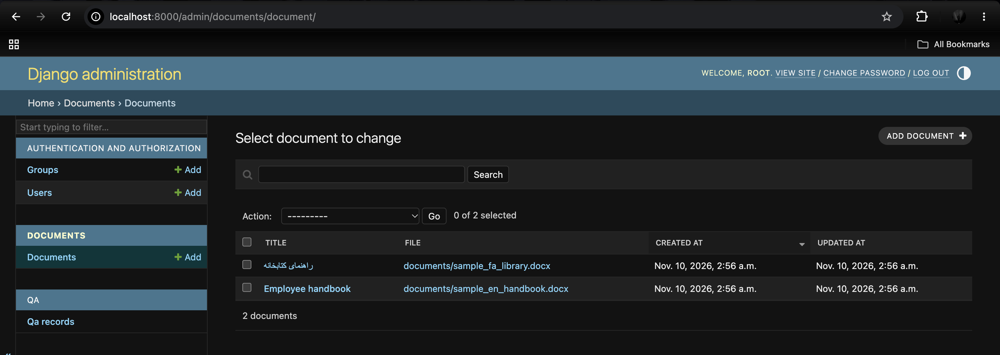
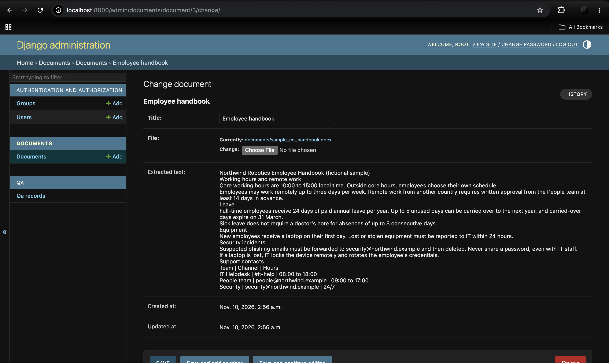
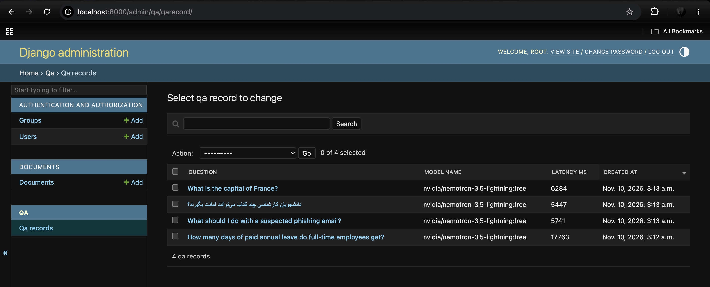
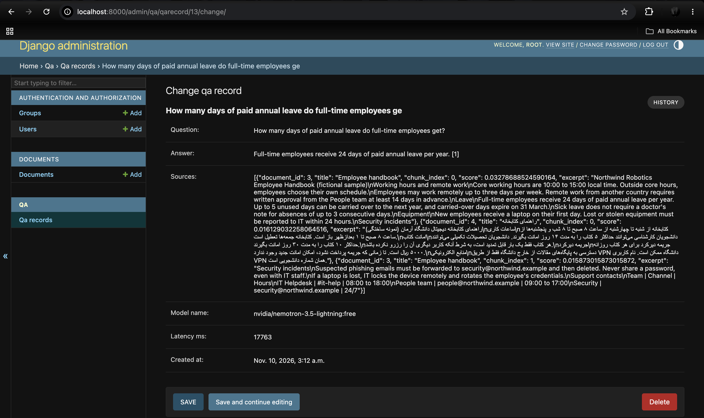
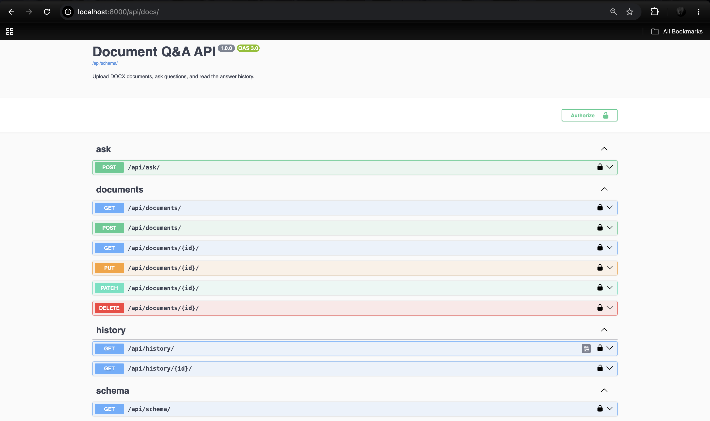

# Document Q&A (RAG) with Django, LangChain and Docker

Upload `.docx` documents, ask questions in English or Persian, and get answers grounded in those
documents, with citations. Every question and answer is saved as history.

- **Django + Django REST Framework:** the documents CRUD API, the ask endpoint and the read-only history.
- **Django Admin:** the user interface for documents and history (no separate frontend).
- **LangChain:** chunking, the Chroma vector store, the prompt and the LLM chain (`prompt | llm | parser`).
- **Hybrid retrieval:** dense search (multilingual E5 embeddings) and BM25, fused with Reciprocal Rank Fusion.
- **LLM:** any OpenRouter chat model, set in `.env` (the default is a free model).
- **Docker Compose:** one command runs everything, with named volumes for the database, index, uploads and model cache.

## Quick start (Docker)

Requirements: Docker with Compose, and an OpenRouter API key (free at https://openrouter.ai/keys).

```bash
cp .env.example .env          # then set DJANGO_SECRET_KEY and OPENROUTER_API_KEY
docker compose up --build
docker compose exec web python manage.py createsuperuser
```

| URL | What |
|---|---|
| http://127.0.0.1:8000/admin/ | Django Admin: upload, edit and delete documents; browse Q&A history |
| http://127.0.0.1:8000/api/docs/ | Swagger UI (interactive API documentation) |
| http://127.0.0.1:8000/api/schema/ | OpenAPI 3 schema (a static copy is in `docs/openapi.yml`) |

The first document upload downloads the embedding model (about 470 MB) into the `hf_cache` volume, so it
can take a minute. Later starts reuse the cache. The first question after a restart takes a few extra
seconds while the model loads into memory.

Data survives `docker compose down` and `up`. `docker compose down -v` deletes the volumes: the database,
the Chroma index, the uploaded files and the model cache.

### Try it with the sample data

`sample_data/` has one English and one Persian document, plus `questions.md` with questions and expected answers.

```bash
curl -F "title=Employee handbook" -F "file=@sample_data/sample_en_handbook.docx" http://127.0.0.1:8000/api/documents/
curl -F "title=راهنمای کتابخانه" -F "file=@sample_data/sample_fa_library.docx" http://127.0.0.1:8000/api/documents/
curl -H "Content-Type: application/json" -d '{"question": "How many days of paid annual leave do full-time employees get?"}' http://127.0.0.1:8000/api/ask/
```

## Configuration (`.env`)

| Variable | Meaning |
|---|---|
| `DJANGO_SECRET_KEY` | Required. Generate one with the command in `.env.example`. |
| `DJANGO_DEBUG` | `1` for local use. With `0`, uploaded files are not served over HTTP (see limitations). |
| `DJANGO_ALLOWED_HOSTS` | Comma-separated, e.g. `localhost,127.0.0.1` |
| `OPENROUTER_API_KEY` | Your OpenRouter key. Never commit it. |
| `OPENROUTER_MODEL` | Chat model id. Free models change over time; `.env.example` shows how to list them. |
| `OPENROUTER_TIMEOUT` | Seconds before an LLM call is abandoned (default 60). |
| `EMBEDDING_MODEL` | Default `intfloat/multilingual-e5-small`. Changing it requires re-indexing every document. |

## API

Full, interactive documentation is at `/api/docs/`. Summary:

| Method | Path | Purpose | Success | Errors |
|---|---|---|---|---|
| `GET` | `/api/documents/` | List documents | 200 | |
| `POST` | `/api/documents/` | Upload (`multipart`: `title`, `file`) | 201 | 400: wrong extension, invalid or empty DOCX |
| `GET` | `/api/documents/{id}/` | One document, including its full extracted text | 200 | 404 |
| `PATCH` / `PUT` | `/api/documents/{id}/` | Rename and/or replace the file (re-indexed) | 200 | 400, 404 |
| `DELETE` | `/api/documents/{id}/` | Delete the document and its chunks | 204 | 404 |
| `POST` | `/api/ask/` | Ask (`{"question": "..."}`, max 2000 characters) | 201 | 400: blank or too long; 503: the LLM failed |
| `GET` | `/api/history/` | All saved questions and answers, newest first | 200 | |
| `GET` | `/api/history/{id}/` | One saved Q&A | 200 | 404 |

History is read-only through the API (`POST` returns 405). Failed questions (503) are not saved.

Example `POST /api/ask/` response:

```json
{
  "id": 1,
  "question": "How many days of paid annual leave do full-time employees get?",
  "answer": "Full-time employees receive 24 days of paid annual leave per year [1].",
  "sources": [
    {"document_id": 1, "title": "Employee handbook", "chunk_index": 0, "score": 0.0328, "excerpt": "..."}
  ],
  "model_name": "nvidia/nemotron-3.5-lightning:free",
  "latency_ms": 2140,
  "created_at": "2026-11-09T10:00:00Z"
}
```

`[n]` in the answer refers to `sources[n-1]`. `score` is the RRF fusion score: it ranks results, it is not a probability.

## Screenshots

| | |
|---|---|
| Documents list (Admin) |  |
| Document with its full extracted text |  |
| Q&A history (Admin, read-only) |  |
| One answer with its sources |  |
| Swagger API documentation |  |

## How it works

```text
Upload (Admin or API)
  → validate: .docx extension (model) + extract text with python-docx (serializer / admin form)
  → save Document (SQLite) + file (media/)
  → post_save signal → transaction.on_commit → chunk (800 chars, 120 overlap) → E5 embeddings → Chroma

Ask
  → dense search (Chroma, top 20)  ┐
  → BM25 over all chunks (top 20)  ┴→ Reciprocal Rank Fusion → drop duplicate text → top 4 chunks
  → prompt with the chunks inside <context>…</context> → OpenRouter LLM → answer with [n] citations
  → save QARecord (question, answer, sources, model, latency)
```

Layers:

- `documents/`: the `Document` model, Admin, serializer, viewset, and signals that keep Chroma in sync.
- `qa/`: the `QARecord` model, Admin (read-only), the ask view, history viewset, and `services.ask()`.
- `rag/`: plain Python with no Django imports: extraction, chunking, embeddings and vector store, BM25,
  fusion, retrieval, generation and answering. Configuration is passed in, so it can be tested on its own.

## Design decisions

- **Hybrid retrieval with RRF.** Dense search finds paraphrases and works across languages. BM25 finds exact
  terms such as codes, names and numbers, which embeddings often miss. RRF combines them by rank only, so the
  two very different score scales never need to be calibrated (`score = Σ 1/(60 + rank)`).
- **Multilingual E5, run locally.** It handles English and Persian, costs nothing per call, and keeps
  documents on the machine. It needs the `query:` / `passage:` prefixes, which are added in one place. See `docs/adr/0001-embeddings.md`.
- **Persian-aware BM25 tokenizer.** Unicode NFKC, case folding, Arabic ي/ك to Persian ی/ک, and Persian/Arabic digits to Western digits.
- **Chroma is a derived index.** SQLite holds the source of truth (the full extracted text). Signals with
  `transaction.on_commit` re-index after a save and remove chunks after a delete, whichever path made the change (Admin, API or shell).
- **Validation before saving.** An invalid file is rejected with a 400 before anything is written.
- **Grounded prompt.** The model must answer only from the context, cite it, and say when the answer isn't
  there. The context is wrapped in `<context>` tags and treated as data, which stopped document text from hijacking answers in testing.
- **Failure handling.** LLM errors and blank replies become `503` and are not saved. If nothing is retrieved, the LLM isn't called at all.
- **Gunicorn, one worker with 4 threads.** Each worker process would load its own copy of the embedding model,
  and Chroma is a local store. Static files (Admin CSS) are served by WhiteNoise.

## Tests

```bash
python manage.py test
```

19 tests, about 0.1 s, with no network, model or API key needed. The LLM, retrieval and indexing are mocked at
the boundaries, and uploads go to a temporary folder.

- `rag/tests.py`: tokenizer folding, BM25, RRF formula, duplicate removal, DOCX extraction, and the blank-LLM-reply regression.
- `qa/tests.py`: ask returns 201 and saves; 400 for a blank question; 503 saves nothing; history is read-only.
- `documents/tests.py`: upload, wrong extension, fake DOCX, file replacement re-indexes with the new text, delete removes chunks.

## Known limitations

- No authentication: suitable for local use only.
- Indexing runs inside the request. If it fails, the error is only logged, so the API can return 201 for a document that can't be searched yet.
- Uploaded files are served only when `DJANGO_DEBUG=1`. A real deployment needs a web server or object storage for `media/`.
- Replaced or deleted files stay in `media/`.
- List endpoints have no pagination and include the full text.
- `GET /api/` lists only `history`, because two routers share the `api/` prefix.
- BM25 has no stemming or stopwords, so it misses `dog` vs `dogs` and favors short chunks; dense search covers some of this.
  BM25 is rebuilt from Chroma on every question, which is fine for a small corpus only.
- There is no relevance cutoff: off-topic questions rely on the prompt's refusal rule.
- Answers cut off by the token limit aren't detected, and Persian answers may cite `[۱]` instead of `[1]`.
- LLM failures return 503 but aren't logged with details yet.
- Retrieval quality is checked by hand only; there is no evaluation set.

## Next steps

1. Authentication and per-user documents.
2. Background indexing (e.g. Celery) with retries and an indexing status field.
3. An evaluation set (questions with known source chunks) to measure retrieval changes.
4. Pagination, and a list serializer without the full text.
5. Stopwords and stemming for BM25, then a reranker if the evaluation shows a need.
6. Structured logging for LLM failures.

## Local development (without Docker)

```bash
conda create -n roshan-rag python=3.12 && conda activate roshan-rag
pip install --extra-index-url https://download.pytorch.org/whl/cpu -r requirements.txt
cp .env.example .env
python manage.py migrate
python manage.py runserver
```
